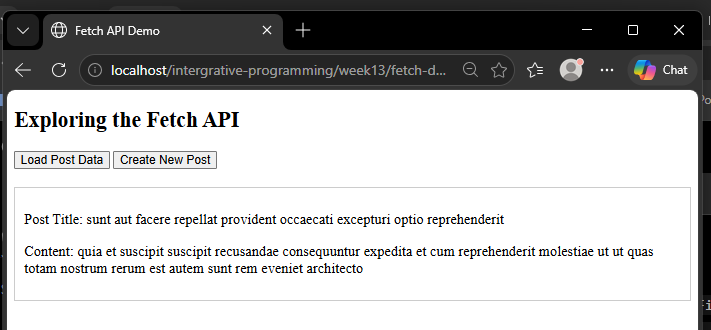
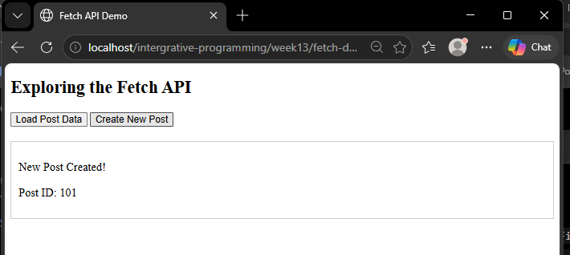

## Screenshots - Fetch API

### Lab Exercise 3

### Get Request

### Post Request

### Guide Questions
Answer the following in a text file named fetch-answers.txt:

[View fetch-answers.txt](fetch-answers.txt)

